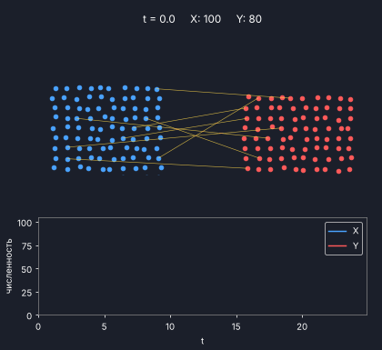

# Уравнения Ланчестера

Модель боя двух группировок: закон квадратов и линейный закон, решение явным методом Эйлера.



## Что делает модель

Численности сторон X и Y обозначены x(t) и y(t). Эффективность бойца X равна a, бойца Y равна b: столько единиц в единицу времени отнимает у противника один боец.

Закон квадратов (хорошо организованный бой):

```
dx/dt = -b*y,   dy/dt = -a*x
```

Сохраняется величина a*x^2 - b*y^2. Побеждает X, если a*x0^2 > b*y0^2. Для этого закона есть точное решение, с ним сравнивается расчёт.

Линейный закон (плохо организованный бой):

```
dx/dt = -b*x*y,   dy/dt = -a*x*y
```

Сохраняется величина a*x - b*y. Побеждает X, если a*x0 > b*y0.

Оба закона считаются методом Эйлера: s(n+1) = s(n) + dt * f(s(n)). Численность после шага не бывает отрицательной. Расчёт кончается, когда одна из сторон стала равна нулю или вышло время.

## Установка и запуск

```
pip install -r requirements.txt
python lanchester.py
python lanchester.py --gif
python -m pytest
```

Первая команда ставит библиотеки, вторая запускает расчёт, третья ещё и делает анимацию, четвёртая запускает тесты.

## Параметры

| Параметр | По умолчанию | Что означает |
| --- | --- | --- |
| `--x0` | 100 | начальная численность X |
| `--y0` | 80 | начальная численность Y |
| `--a` | 0.05 | эффективность бойца X |
| `--b` | 0.06 | эффективность бойца Y |
| `--dt` | 0.1 | шаг по времени |
| `--tmax` | 60 | максимальное время расчёта |
| `--gif` | выключен | сделать анимацию |

Все числовые параметры должны быть положительными, `dt` не больше `tmax`.

## Что на выходе

- вывод в консоль: победитель, остаток победителя (численный и по формуле) и время конца боя для каждого закона; ошибки и наклон при исследовании сходимости; доля клеток карты победы, где победитель совпал с аналитическим; граница победы;
- `results/battle.png` - численность сторон во времени, оба закона;
- `results/phase.png` - фазовая плоскость закона квадратов;
- `results/convergence.png` - ошибка метода Эйлера в зависимости от шага;
- `results/victory_map.png` - карта победы в зависимости от начальных численностей;
- `images/animation.gif` - анимация, 100 кадров (только с `--gif`).

## Как читать результаты

С параметрами по умолчанию побеждает X с небольшим перевесом: a*x0^2 = 500, b*y0^2 = 384. Граница победы в законе квадратов: y0 / x0 = sqrt(a/b), в линейном законе y0 / x0 = a/b. Выше границы побеждает Y, ниже побеждает X.
Наклон на графике сходимости около 1: метод Эйлера первого порядка, при уменьшении шага вдвое ошибка уменьшается вдвое.
В линейном законе проигравший не доходит до нуля точно, его численность только стремится к нулю, поэтому конец боя там считается по уровню 1 бойца.

## Ограничения

- модель упрощённая: численности непрерывны, эффективности постоянны;
- нет подкреплений и потерь по другим причинам;
- только метод Эйлера первого порядка, шаг постоянный;
- сравнение с реальными боями не проводилось.
